# Báo cáo dữ liệu và EDA của người 1

Dữ liệu đã được kiểm tra và làm sạch theo quy tắc cố định, giữ 400 dòng và 24 thuộc tính đầu vào.
EDA đã có 12 biểu đồ kèm nhận xét. Bộ dữ liệu có nhiều ô thiếu và chỉ 158 dòng đầy đủ;
không loại hàng loạt dòng thiếu. Bước tiếp theo là người 2 chia train/test và xây pipeline trên train.

## Mục tiêu và phạm vi

Phân loại nhị phân CKD/Not CKD cho đồ án học máy, phục vụ nhóm sinh viên và giảng viên khi demo.
Đầu vào: 24 thuộc tính, cho phép thiếu; đầu ra mô hình sau này: nhãn và xác suất.
Lớp dương CKD=1. Chỉ số chính Recall CKD, kèm Precision, F1 và ROC-AUC; không coi Accuracy là đủ.
Đây là mục tiêu đánh giá học thuật, không phải chứng nhận khả năng chẩn đoán.

## Chất lượng dữ liệu

| Kiểm tra | Kết quả |
|---|---|
| Kích thước thô | 400 × 26 |
| Sau làm sạch | 400 × 25, gồm 24 X + 1 y |
| Nhãn | 250 CKD (62,5%), 150 Not CKD (37,5%) |
| Thiếu nhãn | 0 |
| Trùng sau bỏ id | 0 |
| Dòng đầy đủ | 158/400 (39,5%) |
| Thiếu pcv / wc / rc | 71 / 106 / 131 |

Đã xử lý khoảng trắng/tab, `?`/chuỗi rỗng, ép kiểu, thống nhất nhãn và loại id; không fit tham số trên toàn bộ dữ liệu.
Bảng số liệu chi tiết: [chất lượng](tables/data_quality.csv), [thống kê số](tables/numeric_summary.csv),
[thống kê phân loại](tables/categorical_summary.csv), [thiếu](tables/missing_values.csv), [tương quan](tables/correlation.csv).
Ý nghĩa và đơn vị: [từ điển dữ liệu](data_dictionary.md). Nguồn và dấu kiểm: [ghi nhận dữ liệu](../data/README.md).

## Quan sát EDA

### Kiểm tra sau làm sạch

Giữ nguyên 400 dòng; bỏ `id` còn 25 cột gồm 24 thuộc tính và nhãn. Không có dòng trùng và không thiếu nhãn.
Ba ô `\t?` ở `pcv`, `wc`, `rc` được chuyển thành thiếu thực sự, mỗi cột tăng một ô thiếu.
Đây là sửa định dạng, không phải tạo dữ liệu mới. Chỉ còn 158 dòng đầy đủ; bỏ mọi dòng thiếu sẽ mất 242/400 dòng (60,5%), nên giữ thiếu để người 2 xử lý bằng imputer fit trên train.

### Nhận xét phân bố lớp

CKD có 250 mẫu (62,5%), Not CKD có 150 mẫu (37,5%), tỷ lệ khoảng 1,67:1.
Luôn đoán CKD đã đạt Accuracy 62,5% và Recall CKD 100%, nhưng Precision chỉ 62,5% và không phân biệt được hai nhóm.
Vì vậy Recall phải được đọc cùng Precision, F1, ROC-AUC và baseline; cần chia dữ liệu có phân tầng.

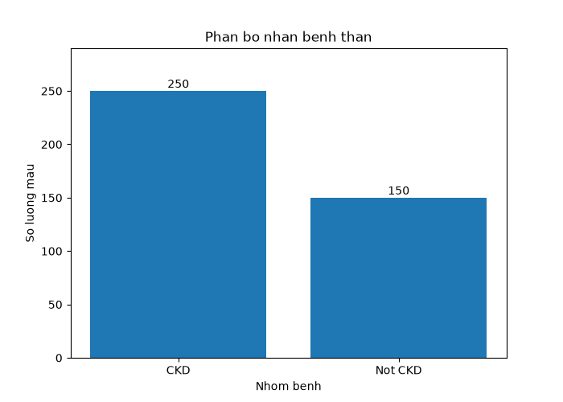

### Nhận xét dữ liệu thiếu

`rbc` thiếu nhiều nhất: 152/400 (38%), tiếp theo `rc` 32,75%, `wc` 26,5%, `pot` 22% và `sod` 21,75%.
Không có nhãn thiếu. Biểu đồ phản ánh tỷ lệ thiếu toàn tập, chưa cho biết cơ chế thiếu.
Không tự loại cột chỉ vì thiếu nhiều; người 2 đánh giá cách xử lý bằng CV trên train. Không điền trung bình hoặc mode trên toàn tập trước khi chia dữ liệu.

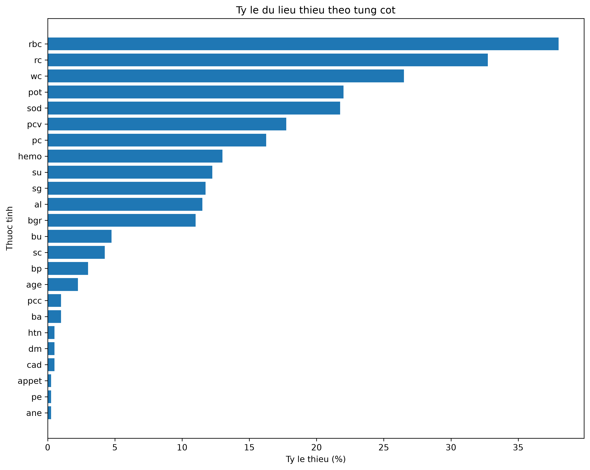

### Nhận xét phân bố tuổi

Có 391 giá trị tuổi, thiếu 9 (2,25%); tuổi từ 2 đến 90, trung bình 51,48 và trung vị 55.
Dữ liệu gồm cả trẻ em và người lớn, nên không mô tả mẫu như chỉ gồm người trưởng thành.
Sự phân bố của mẫu này không đại diện tự động cho dân số.

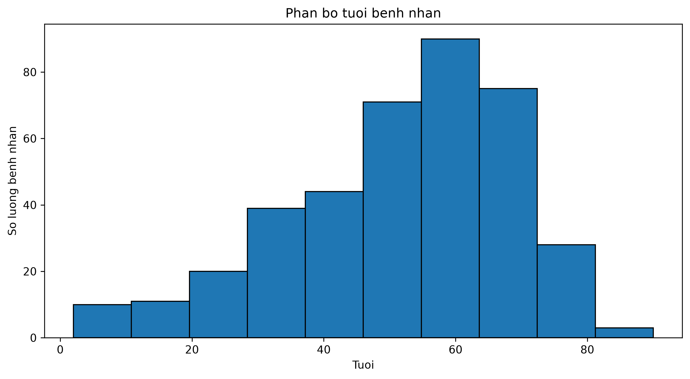

### Nhận xét tuổi theo lớp

Trung vị tuổi CKD là 59 so với 46 ở Not CKD; trung bình lần lượt 54,54 và 46,52.
Hai nhóm vẫn chồng lấp đáng kể, nên tuổi riêng lẻ không xác định nhãn bệnh.
Thống kê bỏ qua ô thiếu: còn 242 mẫu CKD và 149 mẫu Not CKD có tuổi.

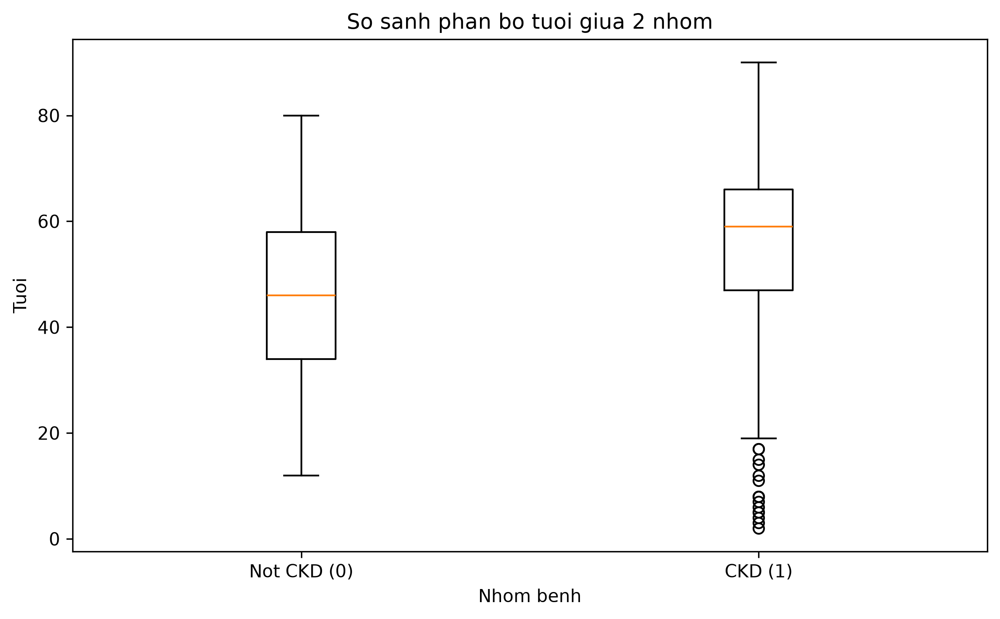

### Nhận xét Hemoglobin

Trung vị `hemo` ở CKD là 10,9 so với 15,0 ở Not CKD; trung bình 10,65 so với 15,19.
Nhóm CKD có xu hướng giá trị thấp hơn, nhưng hai nhóm vẫn chồng lấp. Có 52 ô thiếu (13%).
Đây là liên hệ quan sát trong dataset, không chứng minh nhân quả hoặc tạo ra ngưỡng chẩn đoán.

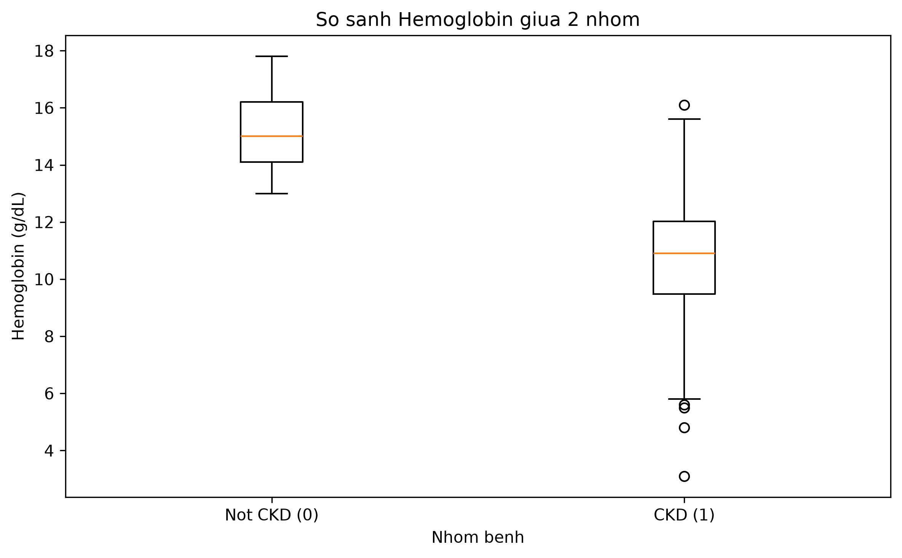

### Nhận xét Serum Creatinine

Trung vị `sc` ở CKD là 2,25 so với 0,90 ở Not CKD; trung bình 4,41 so với 0,87.
Giá trị lớn nhất ở CKD là 76, làm kéo giãn trục và tăng trung bình; cần đọc cả trung vị và boxplot.
Có 17 ô thiếu (4,25%). Không tự xóa điểm cực trị chỉ vì nó lớn; cần kiểm tra nguồn, đơn vị trước, mọi quyết định biến đổi cho mô hình phải đánh giá trên train.

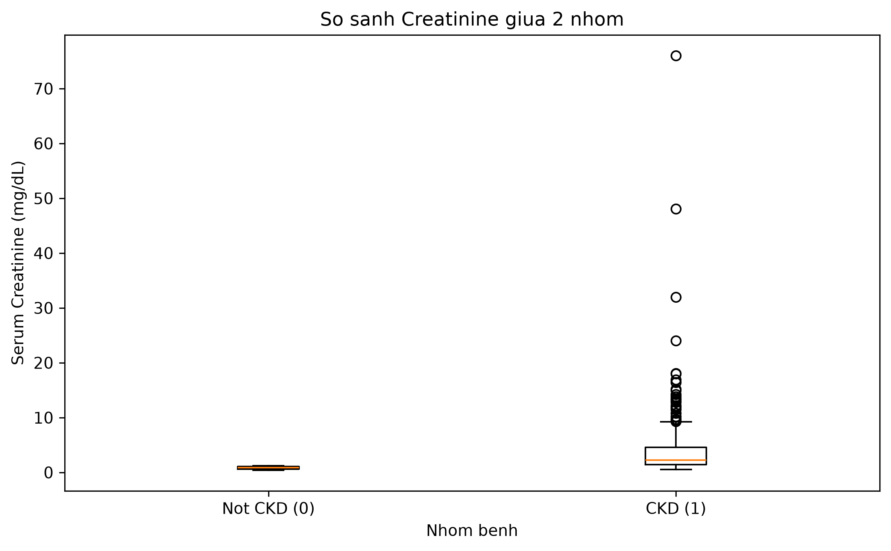

### Nhận xét huyết áp

Trung vị `bp` của CKD là 80 so với 70 ở Not CKD; trung bình 79,62 so với 71,35.
Nhóm CKD có độ phân tán lớn hơn và giá trị tối đa 180; hai nhóm vẫn có phần chồng lấp.
Có 12 ô thiếu (3%). `bp` là số đo huyết áp trong dữ liệu, khác với biến phân loại `htn`; không tự suy ngưỡng lâm sàng từ biểu đồ này.

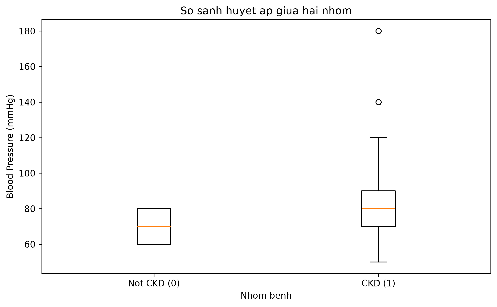

### Nhận xét ma trận tương quan

Kết quả phân tích tương quan Pearson cho thấy một số thuộc tính số có mối liên hệ đáng chú ý với nhãn bệnh thận mãn tính (CKD).

- **Hemoglobin (`hemo`)** có tương quan âm mạnh với CKD (r = -0.77).
- **Packed Cell Volume (`pcv`)** có tương quan âm mạnh với CKD (r = -0.74).
- **Red Blood Cell Count (`rc`)** có tương quan âm mạnh với CKD (r = -0.70).
- **Blood Glucose Random (`bgr`)** có tương quan dương với CKD (r = 0.42).

Ngoài ra, `hemo` và `pcv` có tương quan dương rất mạnh (r = 0.90), cho thấy hai thuộc tính có xu hướng biến thiên cùng nhau.

**Kết luận:** Trong các thuộc tính số được phân tích, `hemo`, `pcv` và `rc` có mối tương quan tuyến tính mạnh nhất với nhãn CKD. Tuy nhiên, tương quan không chứng minh quan hệ nhân quả và chưa đủ để quyết định lựa chọn đặc trưng cho mô hình.

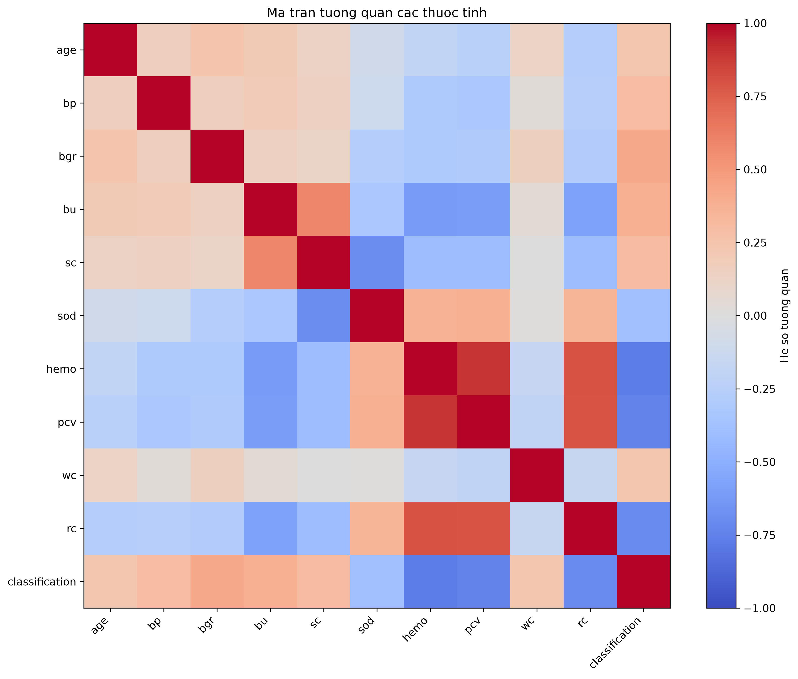

### Nhận xét thuộc tính tăng huyết áp (htn)

Kết quả cho thấy 58,8% bệnh nhân thuộc nhóm CKD có tăng huyết áp, trong khi nhóm Not CKD không ghi nhận trường hợp tăng huyết áp nào. Có 2 mẫu thiếu dữ liệu ở nhóm Not CKD (1,33%).

Điều này cho thấy thuộc tính `htn` có khả năng phân biệt hai nhóm trong dataset. Tuy nhiên, đây chỉ là mối liên hệ quan sát được, không đủ để khẳng định quan hệ nhân quả.

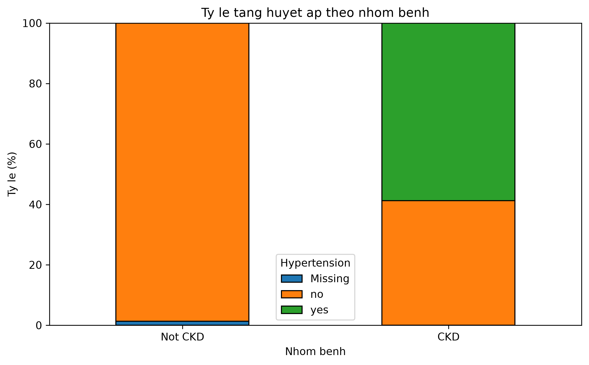

### Nhận xét thuộc tính tiểu đường (dm)

Kết quả cho thấy 54,8% bệnh nhân thuộc nhóm CKD có tiểu đường, trong khi nhóm Not CKD không ghi nhận trường hợp nào. Có 2 mẫu thiếu dữ liệu, đều thuộc nhóm Not CKD.

Thuộc tính `dm` cho thấy sự khác biệt rõ rệt giữa hai nhóm trong dataset. Tuy nhiên, kết quả chỉ phản ánh mối liên hệ thống kê, không chứng minh quan hệ nhân quả.

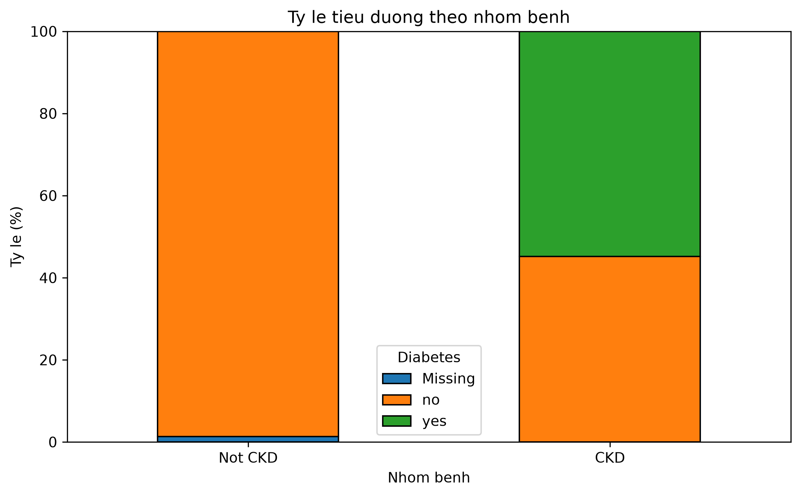

### Nhận xét tình trạng hồng cầu (`rbc`)

CKD có 18,8% `abnormal`, 24,0% `normal` và 57,2% thiếu; Not CKD có 94% `normal`, 6% thiếu và không ghi nhận `abnormal`.
Tỷ lệ tính trên toàn bộ mẫu của từng lớp, có giữ nhóm Missing; không nhầm 18,8% với tỷ lệ chỉ trên các mẫu đã biết `rbc`.
Mức thiếu khác nhau rõ giữa hai lớp, cần lưu ý nguy cơ mô hình học đặc điểm thu thập dữ liệu. `rbc` là tình trạng phân loại, khác `rc` là số lượng hồng cầu.

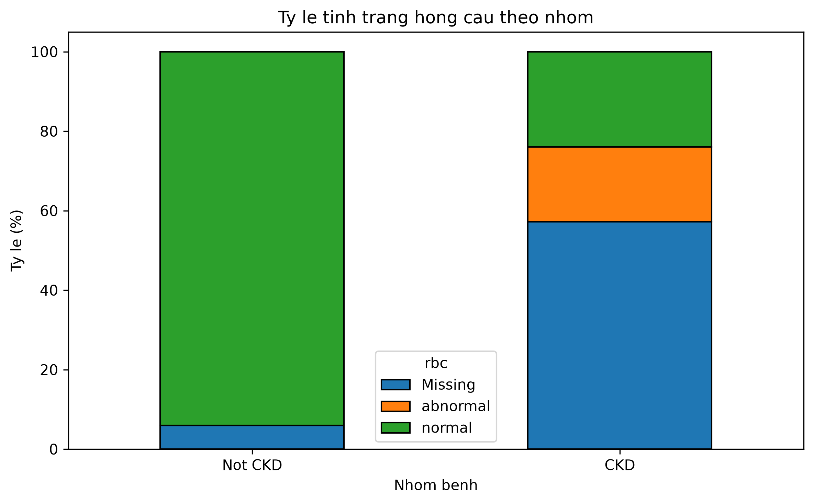

### Nhận xét khẩu vị (`appet`)

CKD có 32,8% `poor`, 67,2% `good`; Not CKD có 99,33% `good` và 0,67% thiếu, không ghi nhận `poor`.
Biến này có khác biệt giữa hai nhóm trong mẫu hiện tại; không suy ra mọi người ăn kém đều mắc CKD.
Các quan sát trên toàn tập không được dùng để chọn đặc trưng qua tập test.

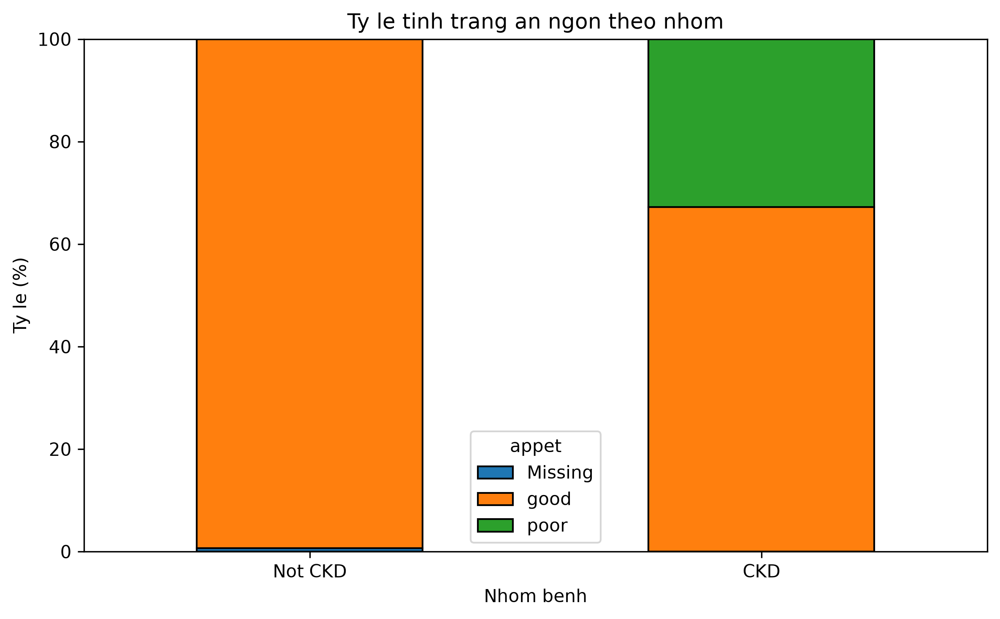

## Giới hạn và quyết định bàn giao

Dữ liệu nhỏ và nhiều giá trị thiếu; thống kê tính trên các giá trị quan sát được. Pearson dùng từng cặp không thiếu nên cỡ mẫu từng cặp khác nhau.
Heatmap mô tả 10 thuộc tính số được chọn và nhãn, không bao quát mọi thuộc tính. Không dùng hệ số tương quan làm chứng cứ duy nhất để loại/chọn biến.
EDA đã xem toàn bộ dataset; nhóm phải công khai việc này và không dùng các quan sát ấy để tinh chỉnh dựa trên test.
Người 2 phải giữ test riêng, fit imputer/encoder/scaler và chọn mô hình bằng CV trên train.
Nếu quá trình sau này dùng quan sát test để ra quyết định thì không còn được mô tả kết quả test là đánh giá hoàn toàn độc lập.
Chưa đánh giá hiệu quả mô hình hoặc khả năng áp dụng ngoài dataset.
Nguồn mô tả gốc đã xác minh; lịch sử tải trực tiếp CSV vẫn cần người tải bổ sung.
